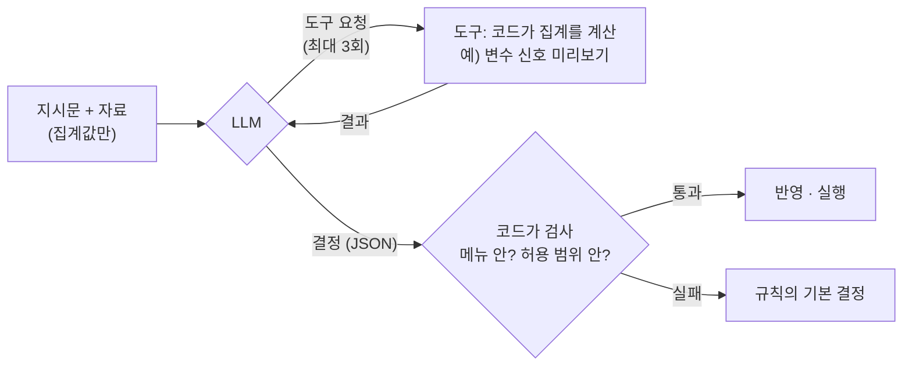
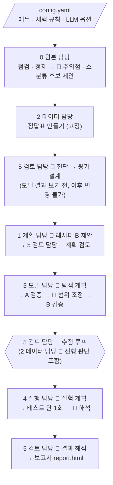
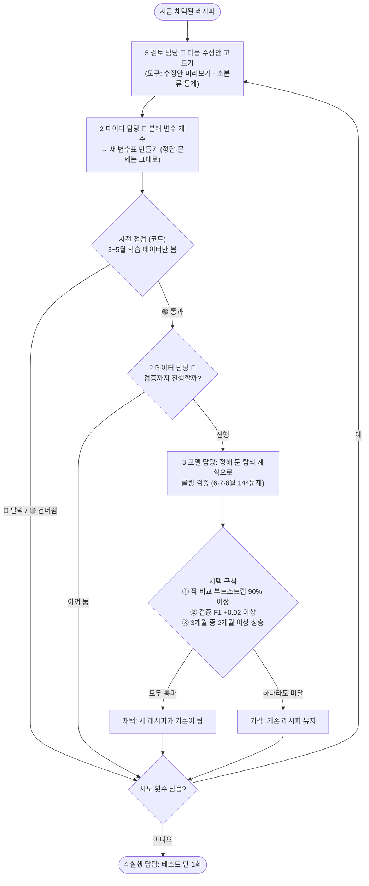
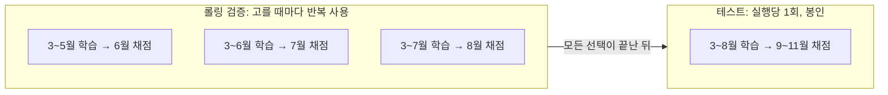

# AutoML-Agent

[2026년 2학기 서울시립대학교 「거래데이터와 AI에이전트」 PBL] 데이터를 넣으면 전처리·모델 선택·검증·보고서까지 스스로 수행하는 AutoML 에이전트


---

## 무엇을 하는 에이전트인가

사람은 `config.yaml`에 **"무엇을 시험해 봐도 되는지(메뉴)"와 "무엇이면 채택할지(규칙)"**만 적습니다.
나머지는 **6개 에이전트**가 작업 노트 하나를 차례로 넘겨받으며 진행합니다.
각 에이전트는 **LLM으로 생각하고**(필요하면 도구로 집계를 조회한 뒤 결정), **코드가 그 결정을 검사·실행**합니다.
결과는 HTML 보고서 한 장으로 나옵니다. 에이전트가 **무엇을 왜 골랐는지**(결정 기록·LLM 대화 전체), 성능, 오류 분석이 들어 있습니다.

## 에이전트 구조

### 6개 에이전트: 생각은 LLM, 실행과 판정은 코드

| # | 에이전트 | LLM이 생각하는 일 (쓸 수 있는 도구) | 코드가 하는 일 | 넘을 수 없는 선 |
|---|---|---|---|---|
| 0 | 원본 담당 | 품질 점검 해석, 비소비성·본사집계 의심 소분류 후보 제안 (소분류 목록·월별 추이 조회) | 원본 CSV 점검·정제, 지역 이름 → 코드 | 원본 행은 안 봄, 중복 삭제 금지 |
| 1 | 계획 담당 | 처음 레시피 B에 켤 변수 (변수 신호 미리보기, 업종별 추이) | 레시피 A(설정값), 레시피 적용 | 메뉴 밖 불가 |
| 2 | 데이터 담당 | 분해 변수 개수, 사전 점검을 통과한 수정안을 진행할지 (지역·중분류 비중 조회) | 정답표(고정)·변수표, 사전 점검 🟢🟡🔴 | 🟡🔴 못 뒤집음, 정답·문제 고정 |
| 3 | 모델 담당 | 탐색할 모델 계열·하이퍼파라미터 범위, 1차 결과를 보고 범위 조정 | 후보를 실제로 학습·롤링 검증 | 허용 범위 안, 채택 규칙으로만 선택 |
| 4 | 실행 담당 | 테스트 전 월별 갱신 실험 계획, 테스트 후 해석 | 테스트 단 1회, 월별 갱신 실험, 예측표 | 테스트 본 뒤 다시 고르기 금지 |
| 5 | 검토 담당 | **모델 전 진단 → 평가 설계**(validation 길이·부트스트랩 단위·test 방식·파생변수), 계획 검토, 다음 수정안·소분류 묶음, 결과 해석 (업종별 달효과, 수정안 미리보기, 소분류 통계) | 진단 계산, 채택 규칙 판정, 보고서 | 평가 설계는 선택지 안에서 모델 결과 전에 1회만, 채택은 규칙이 판정 |

- 번호는 실행 화면의 `[0]`~`[5]` 표시와 같습니다.
- **하이퍼파라미터의 숫자는 탐색 도구가 실제로 학습해서 찾습니다.** 모델 담당 LLM은 "어떤 모델을 어떤 범위로 찾을지"를 정합니다. 그 계획은 모든 레시피에 똑같이 쓰여서 레시피끼리 공정하게 비교됩니다.
- **"레시피"**는 에이전트가 정하는 전처리·변수 선택 한 세트입니다. 어떤 변수를 켤지, 어떤 소분류를 빼거나 따로 볼지, 극단값을 자를지 등을 묶은 것입니다.
- **LLM이 없거나 일부를 끄면** 그 판단은 정해진 규칙이 대신하고, 끝까지 동작합니다. 판단 중요도에 따라 계획·모델·검토·실행은 큰 모델, 원본·데이터는 작은 모델을 씁니다(`config.yaml`에서 변경).

### 에이전트 하나가 생각하는 방식



### 전체 흐름



💭 = 그 에이전트가 LLM으로 생각하는 지점 (실데이터 기준 실행 1회에 약 15회)

### 수정 루프 (에이전트가 스스로 개선하는 부분)



### 평가 데이터 나누기 (한 달 = 48문제)



### 믿을 수 있게 만든 장치

- **정답 고정**: 전처리를 어떻게 바꿔도 맞혀야 할 문제와 정답은 그대로입니다. 문제를 바꿔서 점수를 올릴 수 없습니다.
- **테스트 봉인**: 테스트 데이터는 고르는 데 쓰지 않고, 실행당 한 번만 엽니다.
- **엄격한 채택 규칙**: 같은 문제로 짝지어 비교했을 때 1,000번 중 900번 이상 이기고, 3개월 중 2개월 이상 올라야 채택합니다.
- **과적합 자가 점검**: 처음 레시피와 최종 레시피를 테스트에서 나란히 채점합니다. 최종이 더 낮으면 경고를 띄웁니다.
- **데이터 보안**: 원본을 읽는 코드는 한 파일뿐입니다. 결과와 LLM에는 집계값과 코드화된 지역만 나갑니다.

## 적용 사례: 카드 거래 데이터

**과제**: 고객층(성별×연령 6개) × 업종(8개)의 다음 달 지출이 늘지 줄지 예측 (한 달 48문제, 테스트 144문제)

| 방법 | 테스트 Macro-F1 |
|---|---|
| 단순 규칙 (지난달 방향 유지) | 0.360 |
| 사람이 만든 baseline (로지스틱 회귀) | 0.520 |
| **에이전트** (수정 최대 3회) | **0.623** |

**배운 점**: 수정 횟수를 10회로 늘리자 검증 점수는 0.673까지 올랐습니다. 하지만 테스트는 0.526으로 떨어졌고, 에이전트가 스스로 **"검증 과적합 의심" 경고**를 띄웠습니다. 데이터가 작을수록 많이 시도하는 것이 오히려 해롭다는 점을, 에이전트의 점검 장치가 직접 보여 준 사례입니다.

---

## 팀원용 사용 설명서

### 1. 처음 한 번만: 설치

1. **Python 설치**: [python.org](https://www.python.org/downloads/)에서 3.12 이상을 설치합니다 (3.13에서 시험함). 설치 첫 화면에서 **"Add python.exe to PATH" 체크**를 꼭 하세요.
2. **이 저장소 내려받기**: GitHub에서 `Code` → `Download ZIP` 후 압축을 풉니다. git을 쓰면 `git clone`도 됩니다.
3. **설치 명령 실행**: 압축 푼 폴더(`run.py`가 보이는 곳)에서 주소창에 `powershell`을 입력하고 엔터를 누르면 그 폴더에서 창이 열립니다. 아래 두 줄을 실행하세요.

```powershell
python -m venv .venv
.venv\Scripts\pip install -r requirements.txt
```

### 2. 데이터 넣기

원본 데이터와 결과는 보안상 저장소에 없고, **저장소 폴더 바로 바깥**에 둡니다. 작업 폴더를 하나 만들어 그 안에 저장소를 내려받고, 제공받은 파일을 아래처럼 넣으세요.

```
작업폴더\
├─ automl-agent-2026-2\                              ← 이 저장소 (명령은 모두 여기서 실행)
├─ 데이터\데이터셋(읽으면안됨)\uos_ai_set1_out.csv   ← 원본을 직접 넣는 곳
└─ 결과\                                             ← 실행하면 자동으로 생김
```

위치를 바꾸고 싶으면 `config.yaml > 경로`를 고치면 됩니다.

> ⚠ 원본 데이터는 GitHub·메신저·이메일 등 어디에도 올리거나 보내지 마세요. 데이터 폴더는 저장소 바깥이라 git에 올라가지 않고, 혹시 저장소 안에 넣더라도 `.gitignore`가 데이터 파일(csv·parquet·xlsx 등)을 막습니다.

원본 없이 먼저 연습하려면 **가짜데이터**를 만들어 쓰면 됩니다.

```powershell
.venv\Scripts\python tools\make_fake_raw.py
```

### 3. 실행

```powershell
.venv\Scripts\python run.py --check        # ① 설정 확인 (몇 초). 설정을 바꾼 뒤에는 항상 먼저
.venv\Scripts\python run.py                # ② 실행 (처음 약 5분, 두 번째부터 약 1~3분)

# 가짜데이터로 연습할 때
.venv\Scripts\python run.py --raw ..\데이터\가짜데이터\fake_raw.csv
```

### 4. 결과 보기

저장소 바깥의 `..\결과\03_agent\index.html`을 **더블클릭**하면 실행 목록이 열립니다. 실행 이름을 누르면 그 실행의 보고서가 열립니다. 가짜데이터 결과는 `..\결과\테스트_agent`에 따로 쌓입니다.

보고서에서 볼 곳:
- **1. 요약**: 성공/실패, 테스트 점수, 경고
- **4. 에이전트 결정 과정**: 무엇을 시도했고 왜 채택·기각했는지
- **6. 오류 분석**: 어느 고객층·업종을 틀렸는지

### 5. 설정 바꾸기

`config.yaml`을 메모장이나 VS Code로 열어 고칩니다. 항목마다 한글 설명이 붙어 있습니다.

| 하고 싶은 것 | 고칠 곳 |
|---|---|
| 모델 빼기·넣기 | `후보모델 > 모델이름 > 사용: 예 / 아니오` |
| 에이전트가 시험할 변수·전처리 | 각 항목의 `시험: 예 / 아니오` |
| 수정 시도 횟수 | `판단규칙 > 수정_최대횟수` (권장 3) |
| LLM 사용 | `LLM > 모드: 규칙 / openai / ollama` (아래 6번) |

> 고칠 때는 줄 맨 앞 띄어쓰기를 그대로 두고, `이름: 값`의 콜론 뒤에 한 칸 띄우세요. 틀리면 `--check`가 어디가 틀렸는지 알려 줍니다.

### 6. LLM 연결 (선택)

**LLM 없이도 끝까지 동작합니다.** 기본값 `모드: 규칙`이면 정해진 규칙으로 판단합니다. LLM을 켜면 6개 에이전트가 각자의 판단(위 '에이전트 구조' 표)을 LLM으로 생각해서 정합니다. 제안은 코드의 검사와 실제 검증을 통과해야만 반영됩니다.

- **이번 실행만 LLM 켜기**: `.venv\Scripts\python run.py --llm openai` (모델도 바꾸려면 `--llm-model gpt-4.1`)
- **LLM에게 맡길 일 켜고 끄기**: `config.yaml > LLM > 맡길_일`에서 `원본_해석` / `처음_레시피` / `계획_검토` / `모델_탐색_계획` / `데이터_판단` / `수정안_고르기` / `실행_판단` / `결과_설명`을 각각 `예 / 아니오`
- **에이전트별 모델**: `config.yaml > LLM > 에이전트별_모델` (기본: 계획·모델·검토·실행은 gpt-4.1, 원본·데이터는 gpt-4o-mini)
- **도구 호출 횟수**: `config.yaml > LLM > 도구_호출_최대` (결정 1번에 집계 조회 최대 횟수, 기본 3)
- **LLM이 실제로 받은 프롬프트와 답 보기**: `..\결과\03_agent\runs\<실행>\llm\` 폴더의 `01_처음레시피B.md` 등 (보고서 9절에서도 볼 수 있음)

#### OpenAI API 키 등록

1. [platform.openai.com](https://platform.openai.com/api-keys)에 로그인 → **API keys** → **Create new secret key** → 키(`sk-`로 시작)를 복사합니다.
2. **키 넣기 (한 번만)**: 저장소 최상위 폴더의 `.env.example`을 복사해서 이름을 **`.env`**로 바꾸고, 메모장으로 열어 `=` 뒤에 키를 붙여넣고 저장합니다.

   ```
   OPENAI_API_KEY=sk-여기에키
   ```
   PowerShell로 한 번에 만들려면: `Copy-Item .env.example .env` → `notepad .env`
3. `config.yaml`에서 `모드: openai`로 바꾸고, 사용할 모델 이름을 확인합니다.

   ```yaml
   LLM:
     모드: openai
     openai: { 주소: "https://api.openai.com/v1", 모델: "gpt-4o-mini" }   # 내 계정에서 쓸 수 있는 모델 이름
   ```
4. `run.py --check`에 `LLM: openai`가 나오면 준비 완료입니다.

> 🔒 **키는 비밀번호와 같습니다.** 키는 `.env`에만 쓰세요. `.env`는 GitHub에 올라가지 않도록 막혀 있습니다. `config.yaml`·`.env.example`·코드·채팅·카톡에는 붙여넣지 마세요.
> 💳 OpenAI는 사용한 만큼 요금이 나옵니다. 한 번 실행에 수십 번 호출됩니다. 사용량과 요금은 OpenAI 사이트의 **Usage** 메뉴에서 확인하고, **Limits**에서 월 상한을 걸어 두세요.

#### Ollama (내 컴퓨터에서 실행, 데이터가 밖으로 안 나감)

1. [ollama.com](https://ollama.com)에서 설치 후 실행
2. PowerShell에서 `ollama pull qwen2.5:7b`
3. `config.yaml`에서 `모드: ollama`

#### LLM에게 보내는 정보

업종 이름, 집계 통계, 검증 점수, 지역 코드(R001 등)만 보냅니다. **원본 행·지역 이름·테스트 점수는 보내지 않습니다.** 연결이 안 되거나 엉뚱한 답이 오면 자동으로 규칙 모드로 대체되고, 보고서의 'AI 활용 내역'에 기록됩니다.

### 7. 자주 생기는 문제

| 증상 | 해결 |
|---|---|
| `python`을 찾을 수 없음 | Python을 다시 설치하면서 "Add python.exe to PATH"를 체크 |
| `[중단] 설정 오류` | 안내된 줄을 고친 뒤 `run.py --check`로 확인 |
| `[중단] 원본 파일이 없습니다` | 2번 위치에 파일이 있는지, 파일 이름이 같은지 확인 |
| `OPENAI_API_KEY가 없습니다` | 저장소 최상위에 `.env` 파일이 있는지, 이름이 `.env.txt`로 저장되지 않았는지 확인 |
| `LLM 답을 쓰지 못해 규칙으로 대체` | 키·모델 이름·인터넷 확인. 실행은 정상으로 계속됨 |
| `[오류] ... 보안 폴더의 error_*.log 참고` | 오류 파일에 원본 내용이 섞일 수 있으니 **공유하지 말고** 담당자에게 알리기 |

---

## 폴더 구조

```
run.py             실행 버튼 (전체 흐름이 run_all() 열 줄에 보임)
config.yaml        설정 (메뉴·채택 규칙·LLM)
state.py           작업 노트 양식 (에이전트들이 차례로 채우는 칸)
common.py          공통 도구 (설정 검사, 점수 계산, 채택 규칙)
llm.py             LLM 호출·도구 사용·기록 (규칙/ollama/openai)
agents/            역할별 에이전트 6개
prompts/           에이전트별 LLM 지시문 (일반 글)
dashboard.py       report.html, index.html 그리기
tools/             가짜데이터 생성, 자동 점검, baseline 재현, 결과 보안 점검
docs/              기술 설명, 실패 사례, 작업 이어하기
requirements.txt   필요한 라이브러리
.env.example       OpenAI 키 넣는 양식 (.env로 복사해서 사용)
```

자세한 구조·평가 방식·측정값은 [docs/기술_설명.md](docs/기술_설명.md), 검증 과적합 사례는 [docs/실패사례_검증과적합.md](docs/실패사례_검증과적합.md)에 있습니다.

## 기술

Python · DuckDB(약 5,000만 행 처리) · pandas · scikit-learn · LightGBM · matplotlib · OpenAI 호환 LLM API
